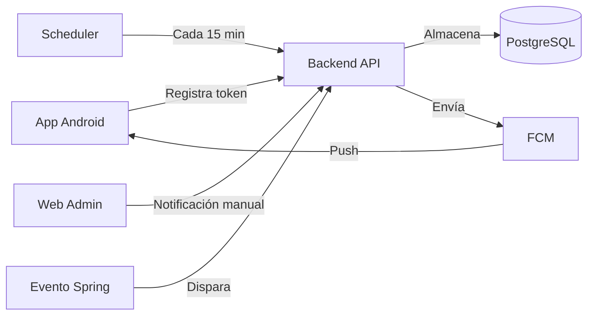

# Requirements

### Overview & Goals
Implementar un sistema de notificaciones push en el ecosistema SyncPass para mantener informados a los usuarios sobre eventos, inscripciones y actualizaciones importantes. Las notificaciones se enviarán mediante Firebase Cloud Messaging (FCM) a la app Android.

### Scope
**In Scope:**
- Backend: Servicio de notificaciones push con FCM, endpoints de gestión de tokens de dispositivo, scheduler para recordatorios
- Mobile: Integración FCM, servicio de tokens, manejo de notificaciones recibidas
- Web: Panel de gestión de notificaciones (envío manual, historial)

**Out of Scope:**
- Notificaciones por email o SMS
- Notificaciones en tiempo real (WebSocket)
- Personalización avanzada de plantillas

### User Stories
1. Como **participante**, quiero recibir recordatorios antes de un evento para no olvidarme de asistir.
2. Como **participante**, quiero saber cuando mi inscripción es aprobada o rechazada.
3. Como **coordinador**, quiero recibir alertas cuando hay asistencias pendientes.
4. Como **administrador**, quiero enviar notificaciones generales a los usuarios.

### Functional Requirements
- **FR-01:** El backend debe enviar notificaciones push a dispositivos registrados vía FCM.
- **FR-02:** La app móvil debe registrar su token FCM en el backend al iniciar sesión.
- **FR-03:** El scheduler debe enviar recordatorios 1 hora y 1 día antes de cada evento.
- **FR-04:** Al cambiar el estado de una inscripción, se debe enviar notificación al participante.
- **FR-05:** El coordinador debe recibir alertas de asistencias pendientes al inicio de un evento.
- **FR-06:** El administrador debe poder enviar notificaciones manuales desde la web.

### Non-Functional Requirements
- **NFR-01:** Las notificaciones no deben bloquear los endpoints existentes (envío asíncrono).
- **NFR-02:** Los tokens FCM deben almacenarse de forma segura en la base de datos.
- **NFR-03:** El sistema debe manejar tokens inválidos o expirados sin fallar.

# Technical Design

### Current Implementation
El backend actual tiene:
- **Spring Boot 4.1.1** con Java 21
- **PostgreSQL** (Supabase) como base de datos
- **Cognito** para autenticación
- **Roles:** ADMINISTRADOR, COORDINADOR, VOLUNTARIO, BENEFICIARIO
- **Dominio:** proyectos, eventos, participantes, inscripciones, asistencias, encuestas
- **Estructura:** `src/main/java/com/backendapp/demo/` con paquetes `api/`, `domain/`, `dto/`, `repository/`, `service/`, `config/`

### Key Decisions
1. **FCM como proveedor:** Es el estándar para Android, gratuito y con buena documentación.
2. **Scheduler + Servicio:** Tareas programadas para recordatorios automáticos, envío inmediato para eventos.
3. **Cola asíncrona:** Spring Events para no bloquear los endpoints existentes.
4. **Persistencia de tokens:** Nueva tabla `dispositivo_push` para almacenar tokens FCM por usuario.

### Proposed Changes

#### Backend (REPO-BE)
1. **Nueva entidad `DispositivoPush`:** Almacena token FCM, usuario asociado, último uso y estado activo.
2. **Nuevo servicio `NotificationService`:** Envía notificaciones vía FCM, maneja tokens inválidos.
3. **Nuevo endpoint `POST /api/notifications/token`:** Registra/actualiza token FCM del dispositivo.
4. **Nuevo endpoint `POST /api/notifications/manual`:** Envía notificación manual (solo ADMINISTRADOR).
5. **Scheduler `NotificationScheduler`:** Envía recordatorios 1 hora y 1 día antes de eventos.
6. **Eventos Spring:** `InscripcionStateChangedEvent`, `EventoStartedEvent` para disparar notificaciones.
7. **Migración Flyway V3:** Crea tabla `dispositivo_push`.

#### Mobile (REPO-MOB)
1. **Integración FCM:** Agregar dependencia Firebase Messaging.
2. **Servicio `SyncPassMessagingService`:** Extiende `FirebaseMessagingService` para manejar tokens y mensajes.
3. **Registro de token:** Al iniciar sesión, enviar token FCM al backend.
4. **Manejo de notificaciones:** Mostrar notificación en el sistema al recibir mensaje.

#### Web (REPO-WEB)
1. **Panel de notificaciones:** Vista para ADMINISTRADOR para enviar notificaciones manuales.
2. **Historial de notificaciones:** Lista de notificaciones enviadas.

### Data Models / Contracts

#### Backend - Nueva Entidad
```java
@Entity
@Table(name = "dispositivo_push")
public class DispositivoPush {
    @Id
    private String id; // UUID
    @Column(name = "fcm_token", nullable = false)
    private String fcmToken;
    @ManyToOne
    @JoinColumn(name = "usuario_id", nullable = false)
    private Usuario usuario;
    @Column(name = "activo")
    private Boolean activo = true;
    @Column(name = "creado_en")
    private LocalDateTime creadoEn;
    @Column(name = "actualizado_en")
    private LocalDateTime actualizadoEn;
}
```

#### Backend - DTOs
```java
// Registro de token
public record TokenRequest(String fcmToken) {}

// Notificación manual
public record ManualNotificationRequest(
    String titulo,
    String cuerpo,
    List<String> roles // null = todos
) {}

// Respuesta de notificación
public record NotificationResponse(
    String mensaje,
    LocalDateTime enviadoEn
) {}
```

#### Backend - Endpoints
```
POST /api/notifications/token       // Autenticado: registrar token FCM
POST /api/notifications/manual      // ADMINISTRADOR: enviar notificación manual
GET  /api/notifications/historial   // ADMINISTRADOR: ver historial
```

#### Contrato FCM (Backend → FCM)
```json
{
  "message": {
    "token": "fcm_token_aqui",
    "notification": {
      "title": "Recordatorio de evento",
      "body": "El evento 'X' comienza en 1 hora"
    },
    "data": {
      "tipo": "recordatorio",
      "evento_id": "123"
    }
  }
}
```

### File Structure
```
src/main/java/com/backendapp/demo/
├── api/
│   └── NotificationController.java          # Nuevo
├── domain/
│   ├── DispositivoPush.java                 # Nuevo
│   └── NotificationHistorial.java           # Nuevo (opcional)
├── dto/
│   ├── TokenRequest.java                    # Nuevo
│   ├── ManualNotificationRequest.java       # Nuevo
│   └── NotificationResponse.java            # Nuevo
├── repository/
│   └── DispositivoPushRepository.java       # Nuevo
├── service/
│   ├── NotificationService.java             # Nuevo
│   └── FcmClient.java                       # Nuevo
├── scheduler/
│   └── NotificationScheduler.java           # Nuevo
├── event/
│   ├── InscripcionStateChangedEvent.java    # Nuevo
│   └── NotificationEventListener.java       # Nuevo
└── config/
    └── FcmConfiguration.java                # Nuevo

src/main/resources/db/migration/
└── V3__add_push_notifications.sql           # Nuevo
```

### Architecture Diagram


### Risks
- **Riesgo 1:** FCM puede cambiar su API o tener límites de rate. **Mitigación:** Implementar retry con backoff y monitorear errores.
- **Riesgo 2:** Tokens inválidos pueden acumularse. **Mitigación:** Marcar como inactivos al recibir error de FCM.
- **Riesgo 3:** Notificaciones no entregadas si la app no está en primer plano. **Mitigación:** Usar mensajes de datos con notificación en el cliente.

# Delivery Steps

### ✓ Step 1: Backend - Modelo y Migración
Crear la entidad `DispositivoPush`, repositorio y migración Flyway V3 para almacenar tokens FCM.
- Crear `DispositivoPush.java` con campos: id, fcmToken, usuario, activo, creadoEn, actualizadoEn.
- Crear `DispositivoPushRepository.java` con métodos para buscar por token y por usuario.
- Crear migración `V3__add_push_notifications.sql` con tabla `dispositivo_push` y relación con `usuario`.
- Impacto en Web/Móvil: El móvil necesitará enviar el token FCM al backend; la web no se ve afectada aún.

### ✓ Step 2: Backend - Servicio FCM y Endpoints
Implementar el servicio de notificaciones con FCM y los endpoints de gestión.
- Crear `FcmClient.java` para comunicarse con la API de FCM (HTTP v1).
- Crear `NotificationService.java` con lógica de envío, manejo de tokens inválidos y registro de tokens.
- Crear `NotificationController.java` con endpoints:
  - `POST /api/notifications/token` (autenticado): registrar token FCM.
  - `POST /api/notifications/manual` (ADMINISTRADOR): enviar notificación manual.
  - `GET /api/notifications/historial` (ADMINISTRADOR): ver historial.
- Crear `FcmConfiguration.java` para configurar credenciales FCM.
- Impacto en Web/Móvil: El móvil consumirá el endpoint de token; la web consumirá el endpoint manual y historial.

### ✓ Step 3: Backend - Scheduler y Eventos
Implementar el scheduler para recordatorios y eventos Spring para notificaciones automáticas.
- Crear `NotificationScheduler.java` con tarea cada 15 minutos para enviar recordatorios 1 hora y 1 día antes de eventos.
- Crear `InscripcionStateChangedEvent.java` y `NotificationEventListener.java` para disparar notificaciones al cambiar estado de inscripción.
- Integrar con `InscripcionService.java` existente para disparar eventos.
- Impacto en Web/Móvil: No hay impacto directo, pero los usuarios recibirán notificaciones automáticas.

### ✓ Step 4: Mobile - Integración FCM
Integrar FCM en la app Android y registrar tokens en el backend.
- Agregar dependencia Firebase Messaging al `build.gradle`.
- Crear `SyncPassMessagingService.java` que extienda `FirebaseMessagingService`.
- Implementar `onNewToken()` para enviar el nuevo token al backend.
- Implementar `onMessageReceived()` para manejar notificaciones.
- Actualizar el flujo de login para registrar el token después de autenticarse.
- Impacto en Backend: Requiere que el endpoint de token esté disponible.

###   Step 5: Web - Panel de Notificaciones
Crear panel de gestión de notificaciones para administradores en la web.
- Crear componente UI para enviar notificaciones manuales.
- Crear vista de historial de notificaciones.
- Integrar con endpoints del backend: `POST /api/notifications/manual` y `GET /api/notifications/historial`.
- Impacto en Backend: Requiere que los endpoints estén disponibles y documentados.

### ✓ Step 6: Backend - CRUD de Cursos (Proyectos)
Agregar CRUD completo de cursos (sinónimo de Proyecto) con permisos de ADMINISTRADOR.
- Crear DTOs: `CursoResponse`, `CursoCreateRequest`, `CursoUpdateRequest`.
- Crear `CursoService` con listar, obtener, crear, editar y desactivar (cambiar estado a FINALIZADO).
- Crear `CursoController` con endpoints REST protegidos.
- Filtrar cursos FINALIZADO del catálogo para la app Android.
- Agregar reglas de seguridad en `SecurityConfiguration`.
- Agregar pruebas de CRUD, validación y permisos (403 para no ADMINISTRADOR).
- Impacto en Web: El panel web consumirá estos endpoints para gestionar cursos.