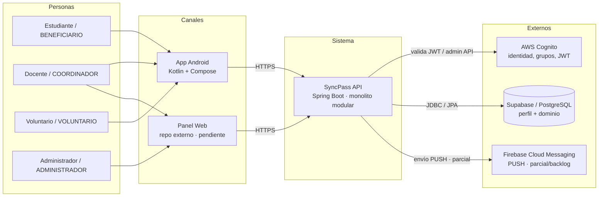
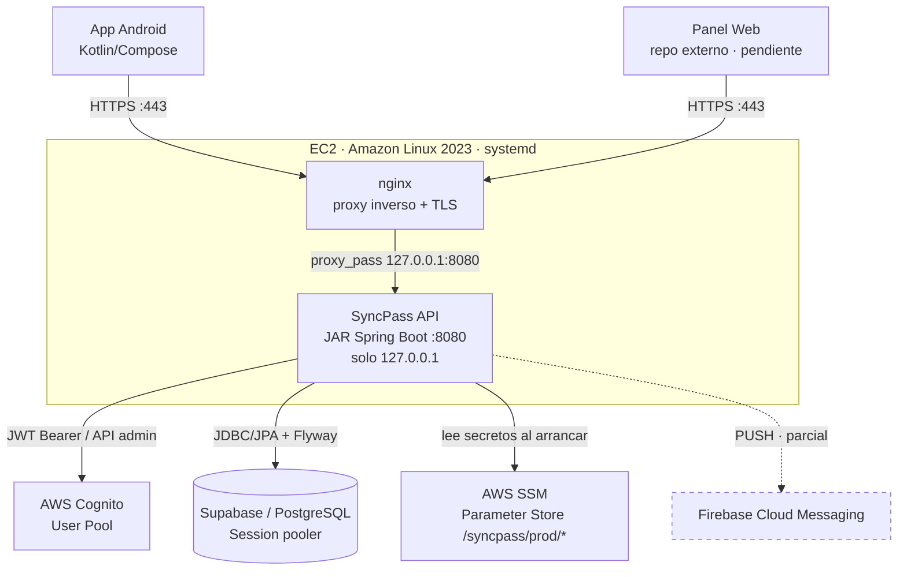
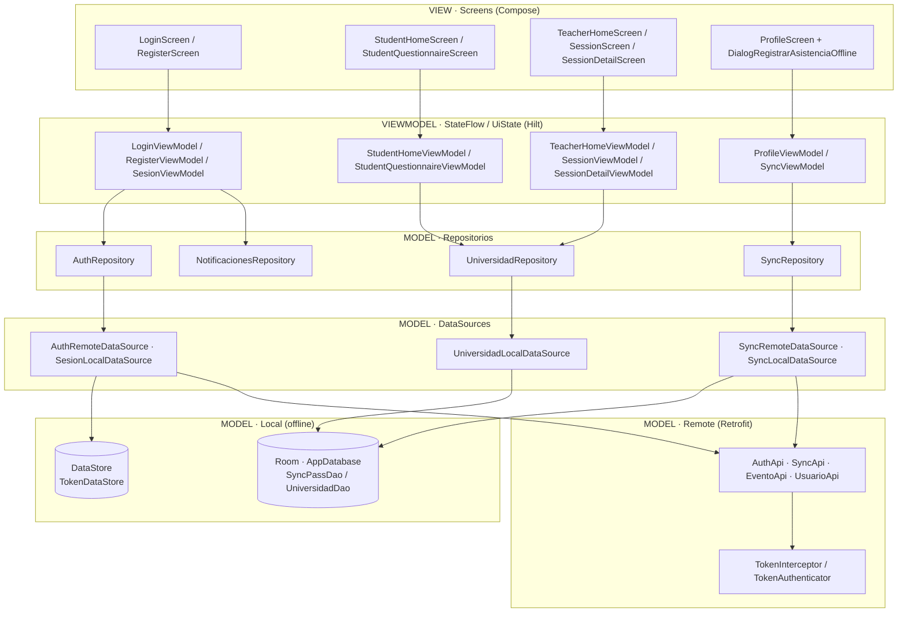

# Arquitectura — SyncPass Backend (modelado C4)

> **Estado del documento (17-11-2026):** describe el **código real** de `monolito_backend_syncpass`
> y su contrato con los repositorios móvil/web. Los diagramas C2 muestran la topología **prevista**
> por los scripts de `deploy/`. La **disponibilidad actual de Supabase / EC2 / Cognito / Parameter Store / FCM
> NO fue verificada en esta revisión**: los scripts y la configuración están preparados, pero no se afirma
> que los recursos estén activos ni que el despliegue esté operativo. Tampoco se afirma que exista AWS
> API Gateway (es opcional en la rúbrica y **no está desplegado**): el tráfico entra por **nginx en EC2**,
> que actúa como proxy inverso.

## 0. Leyenda de estado (usada en todo el documento)

| Etiqueta | Significado |
|---|---|
| **Código** | Implementado y presente en este repositorio. |
| **Tests H2** | Cubierto por pruebas automáticas con H2 + Cognito simulado; no prueba conectividad cloud. |
| **Nube (no verificada)** | Scripts/configuración listos; disponibilidad real NO comprobada en esta revisión. |
| **Desplegado** | Solo se documenta el mecanismo de publicación; no se declara instancia activa verificada. |
| **E2E Android** | Prueba extremo a extremo con la app; solo se documenta lo históricamente verificado. |

---

## 1. C1 — Contexto del sistema

SyncPass reemplaza planillas de papel en actividades comunitarias: acreditación por QR, trabajo sin
conexión (offline-first), encuestas inmediatas y reportes. El sistema interactúa con cuatro perfiles de
usuario y varios sistemas externos.

### 1.1 Perfiles y equivalencia de roles

Los perfiles de negocio de la rúbrica se implementan como **grupos de Cognito** (`cognito:groups`),
sin crear ni renombrar roles. La equivalencia documentada es:

| Perfil (rúbrica / producto) | Grupo Cognito (= `Rol`) | Permisos clave en la API |
|---|---|---|
| Administrador | `ADMINISTRADOR` | Usuarios, cursos (escritura), reportes, métricas, notificación manual/historial |
| Docente | `COORDINADOR` | Métricas y reportes; catálogo y sync |
| Voluntario | `VOLUNTARIO` | Catálogo y sync (usuario autenticado) |
| Estudiante | `BENEFICIARIO` | Catálogo y sync (usuario autenticado); es el rol del auto-registro |

**Precisión sobre «Estudiante» y `TipoParticipante`:**

- **Estudiante ↔ `BENEFICIARIO`.** El perfil «Estudiante» de la rúbrica corresponde al grupo Cognito
  `BENEFICIARIO`, que es el de menor privilegio y el que se asigna automáticamente en
  `POST /api/auth/registro` (`UsuarioService.ROL_REGISTRO`). Es una **autoridad de seguridad**:
  determina qué endpoints puede invocar.
- **`TipoParticipante.ESTUDIANTE` / `TipoParticipante.DOCENTE` NO son roles Cognito.** Son valores del
  enum `com.backendapp.demo.domain.TipoParticipante` (`ESTUDIANTE`, `VECINO`, `DOCENTE`) que clasifican
  a una **persona marcada** en una asistencia o encuesta (quién asistió), y se persisten en
  `Asistencia.tipoParticipante` / `Participante.tipo`. No otorgan permisos, no aparecen en
  `cognito:groups` y no se usan en `hasRole(...)`. Un mismo `BENEFICIARIO` puede marcar asistencias de
  tipo `ESTUDIANTE`, `VECINO` o `DOCENTE` sin que cambie su rol.

*Fuente de verdad del rol:* el grupo de Cognito. `Rol.principal(...)` elige el de mayor privilegio
cuando un usuario tiene varios; `UsuarioService.login` sincroniza ese valor al perfil local.

### 1.2 Sistemas externos y alcance

| Sistema | Rol | Estado |
|---|---|---|
| **AWS Cognito** | User Pool: contraseñas, grupos y emisión de access tokens. El backend valida el JWT y usa la API admin para alta/baja/cambio de estado. | Código + tests con mock; connection real no verificada en esta revisión. |
| **Supabase / PostgreSQL** | Persistencia de perfil y dominio (proyectos, eventos, inscripciones, participantes, asistencias, encuestas). Flyway `ddl-auto=validate`. | Código + scripts + tests H2; conexión/disponibilidad actual no verificada. |
| **Firebase Cloud Messaging** | Envío de push (manual, recordatorios, eventos de inscripción). | **Parcial / backlog**: ver `ALCANCE.md` y el aviso en `API_CONTRACT_NOTIFICACIONES.md`. |
| **nginx en EC2** | Proxy inverso HTTPS → `127.0.0.1:8080`. | Scripts preparados; instancia/HTTPS no verificados en esta revisión. |
| **AWS API Gateway** | Opcional según la rúbrica. | **No desplegado.** No se dibuja en el flujo real (C2). |

---

## 2. C2 — Contenedores (topología REAL)

**Puntos clave del C2 real:**

1. **No hay API Gateway desplegado.** El único punto de entrada es nginx en EC2
   (`deploy/server/nginx-syncpass.conf`): `listen 80` con redirección HTTPS vía `setup-https.sh`,
   `client_max_body_size 2m` (lotes de hasta 500 registros) y `proxy_pass http://127.0.0.1:8080`.
2. **El puerto 8080 no se expone** (`SERVER_ADDRESS=127.0.0.1` en `deploy/server/start.sh`); el
   Security Group abre solo 80/443 (y SSH restringido).
3. **Sin secretos en disco ni en Git.** `start.sh` obtiene `DB_URL`, `DB_USER`, `DB_PASSWORD`,
   `COGNITO_ISSUER`, `COGNITO_CLIENT_ID` y `COGNITO_USER_POOL_ID` desde
   `/syncpass/prod/*` (Parameter Store, SecureString) usando el rol IAM de la instancia
   (`deploy/parameter-store.ps1`, `deploy/iam-policy.json`).
4. **Cognito** es externo a la EC2: el backend valida firma, issuer, expiración, `token_use=access` y
   `client_id` (`SecurityConfiguration#jwtDecoder`) y llama a la API admin solo en altas de usuario
   (`CognitoService`).
5. **Supabase** se alcanza por el Session pooler con `sslmode=require`
   (`spring.datasource.url=${DB_URL:...}`). Flyway aplica V1/V2 y la migración V3 preparada para
   notificaciones; Hibernate queda en `validate`.
6. **FCM** se muestra en trazo discontinuo porque su integración es parcial (backlog).

### 2.1 Estado real de despliegue y verificación

| Capacidad | Estado honesto |
|---|---|
| Código Spring Boot, contrato REST, reglas de seguridad | **Código** |
| 69 tests, 0 fallos, JaCoCo ≥ 30% (72,6 % líneas) | **Tests H2** (Cognito simulado; sin AWS/Supabase reales) |
| Scripts EC2 / nginx / HTTPS / Parameter Store / IAM | **Código → Nube (no verificada en esta revisión)** |
| Login móvil con cuenta real | **E2E Android** (documentado históricamente; no reproducido en esta revisión) |
| Catálogo + sync + reportes desde la app | **E2E Android pendiente** |
| Disponibilidad actual de `https://syncpass.duckdns.org/api/health` | **No verificada en esta revisión**; comprobarla antes de afirmar disponibilidad |

> No se declaran requisitos cloud como cumplidos. Para verificar: `Invoke-RestMethod
> 'https://<dominio>/api/health'` y revisar `systemctl status syncpass nginx` en la EC2.

---

## 3. C3 — Componentes: arquitectura MVVM de la app Android

C3 se enfoca en la app (repo `syncpass-movil`, paquete `com.example.syncpassapp`, Kotlin + Jetpack
Compose + Hilt). El backend expone REST/JSON; la app organiza sus capas así (detalle completo en
`docs/ARQUITECTURA.md` del repo móvil):

**Capas y responsabilidades:**

| Capa | Clases reales (repo móvil) | Responsabilidad |
|---|---|---|
| View (Screens) | `feature/*/ui/*Screen.kt`, `core/designsystem/components/*` | Componer UI, observar `StateFlow`, disparar eventos del ViewModel. |
| ViewModel | `*ViewModel.kt` (`@HiltViewModel`), `uiState: StateFlow<*UiState>` | Lógica de presentación; expone estado inmutable; **solo** depende de repositorios (ninguno recibe DAO, API ni `Context`). |
| Repositorios | `core/database/repository/SyncRepository.kt`, `UniversidadRepository.kt`, `feature/auth/data/AuthRepository.kt`, `feature/notificaciones/data/NotificacionesRepository.kt` | Reglas de negocio y coordinación local/remoto (offline-first); trabajan contra los datasources. |
| DataSources | `core/datasource/local/{SyncLocalDataSource,UniversidadLocalDataSource,SesionLocalDataSource}.kt`, `core/datasource/remote/{SyncRemoteDataSource,AuthRemoteDataSource}.kt` | Únicas clases que usan DAOs, APIs de Retrofit y DataStore. |
| Local | `core/database/local/database/AppDatabase.kt` (Room v3, `SyncPassDao`, `UniversidadDao`), `core/datastore/TokenDataStore.kt` | Caché del catálogo, cola de asistencias/encuestas pendientes, token de sesión. |
| Remote | `core/network/remote/{AuthApi,SyncApi,EventoApi,UsuarioApi}.kt`, `TokenInterceptor`, `TokenAuthenticator` | Llamadas HTTP al backend; interceptor inyecta `Authorization: Bearer`. |

**Roles en la app:** `core/common/auth/Rol` traduce los grupos de Cognito a los perfiles de la rúbrica
(BENEFICIARIO → Estudiante, COORDINADOR → Docente, VOLUNTARIO → Voluntario, ADMINISTRADOR →
Administrador); Docente, Voluntario y Administrador entran al inicio docente.

**Coherencia con el backend:**

- `SyncApi` declara exactamente `GET api/sync/catalogo`, `POST api/sync/asistencias` y
  `POST api/sync/encuestas` (ver `SyncController`). No existe `POST /api/sync/confirmar-registro` en
  el backend.
- `SyncRepository.descargarYGuardarCatalogo()` persiste proyectos/eventos/participantes/inscripciones
  en Room; `sincronizarAsistenciasPendientes()` / `sincronizarEncuestasPendientes()` envían la cola y
  marcan como sincronizados tanto `aceptados` **como** `duplicados` (reintento seguro).
- `AuthApi` contiene login, registro, confirmar y reenviar-código. **No hay endpoint de refresh en el
  backend**: `TokenAuthenticator` limpia los tokens ante un 401 y la app debe pedir un nuevo login.
  El modelo `RefreshTokenRequest` / `getRefreshToken()` existe en la app pero no tiene contrato en la
  API (ver backlog en `ALCANCE.md`).

---

## 4. Trazabilidad a clases reales del backend

| Responsabilidad | Clase(s) real | Archivo |
|---|---|---|
| Arranque / composición | `SyncPassApiApplication` (`@SpringBootApplication`, `@EnableScheduling`) | `src/main/java/com/backendapp/demo/SyncPassApiApplication.java` |
| Seguridad y JWT | `SecurityConfiguration` (`securityFilterChain`, `jwtAuthenticationConverter`, `jwtDecoder`) | `config/SecurityConfiguration.java` |
| Propiedades Cognito | `CognitoProperties` | `config/CognitoProperties.java` |
| Cliente/admin Cognito | `CognitoService` | `service/CognitoService.java` |
| Login, registro, usuarios | `UsuarioService`, `AuthController`, `UsuarioController` | `service/`, `api/` |
| Sync offline | `SyncController`, `SyncService`, `CatalogoService` | `api/`, `service/` |
| DTOs del contrato | `AsistenciaLoteRequest`, `EncuestaLoteRequest`, `ResultadoSyncResponse`, `ErrorResponse`, … | `dto/` |
| Dominio | `Asistencia`, `Encuesta`, `Participante`, `Evento`, `Proyecto`, `Inscripcion`, `Rol`, `TipoParticipante` | `domain/` |
| Repositorios | `AsistenciaRepository`, `EncuestaRepository`, `EventoRepository`, `ParticipanteRepository`, `ProyectoRepository`, `InscripcionRepository`, `UsuarioRepository`, `RolRepository` | `repository/` |
| Reportes | `ReporteController`, `EventoController`, `ReporteService` | `api/`, `service/` |
| Cursos (proyectos) | `CursoController`, `CursoService` | `api/`, `service/` |
| Notificaciones (parcial) | `NotificationController`, `NotificationService`, `FcmClient`, `NotificationScheduler`, eventos de inscripción | `api/`, `service/`, `scheduler/`, `event/` |
| Errores uniformes | `GlobalExceptionHandler` → `{"error":"..."}` | `api/GlobalExceptionHandler.java` |
| Esquema | Flyway `V1__create_roles_and_users.sql`, `V2__dominio_syncpass.sql` y `V3__add_push_notifications.sql` (preparada, notificaciones) | `src/main/resources/db/migration/` |
| Datos de ejemplo | `DatosSemilla` (ficticios, solo si no hay proyectos) | `config/DatosSemilla.java` |

### 4.1 Flujo de autenticación (real)

1. La app envía `POST /api/auth/login` con `{username, password}` (público).
2. `UsuarioService.login` llama a Cognito (`CognitoService.login`) fuera de la transacción; obtiene
   `accessToken`, `cognitoSub`, `username` y grupos.
3. `Rol.principal(groups)` define el rol (fuente de verdad = Cognito). Sin grupo válido → `403`.
4. Se crea/actualiza el perfil local por `cognitoSub` (con compensación por `username`); usuario
   desactivado → `403`. La respuesta es `{token, usuario:{id, username, nombre, rol}}`.
5. En cada petición posterior, `SecurityConfiguration` valida el JWT Bearer:
   `NimbusJwtDecoder` con JWKS del issuer, validación de issuer + timestamp, `token_use=access` y
   `client_id`. Los grupos `cognito:groups` se convierten en autoridades `ROLE_<GRUPO>`.
6. `hasRole(...)` aplica el RBAC (ej. `/api/usuarios/**` → `ADMINISTRADOR`;
   `/api/reportes/**` y métricas → `COORDINADOR` o `ADMINISTRADOR`).
7. Errores 401/403 se serializan como `{"error":"..."}` (`entradaNoAutenticada`,
   `accesoDenegado`). La sesión es `STATELESS`, CSRF desactivado.

### 4.2 Flujo offline e idempotencia (real)

1. Con conexión, la app descarga `GET /api/sync/catalogo` (`CatalogoService.obtenerCatalogo`):
   proyectos no `FINALIZADO`, eventos, participantes e inscripciones. Lo guarda en Room.
2. Sin conexión, la app registra asistencias/encuestas localmente con un `uuid` generado en el
   dispositivo (cola de pendientes).
3. Al recuperar conexión (sincronización explícita), envía lotes a
   `POST /api/sync/asistencias` / `POST /api/sync/encuestas` (`SyncService`, `@Transactional`).
4. Reglas de `SyncService` (evaluadas **por registro**, un registro malo no invalida el lote):

   | Situación | Resultado |
   |---|---|
   | `uuid` ya recibido | `duplicados` → reintento seguro |
   | Mismo evento + participante con otro `uuid` | `duplicados`; se conserva la marca **más temprana** |
   | Evento inexistente / campos inválidos / enum inválido / coordenadas fuera de rango | `rechazados` con motivo |
   | Participante desconocido (inscripción en sitio `W-…`) | se crea con alias `Inscrito en sitio` |
   | Registro válido | `aceptados` |

5. `RegistradoPor` se toma del usuario autenticado (`usuarioService.idLocal(sub)`) cuando el lote no
   lo especifica; la latitud/longitud/distancia se validan y la distancia debe ser finita.
6. La respuesta `ResultadoSyncResponse` devuelve `aceptados`, `duplicados`, `rechazados` y `serverTime`.
   La app marca como sincronizados tanto `aceptados` como `duplicados`, evitando reenvíos infinitos.

---

## 5. Decisiones de diseño

- **Monolito modular:** una sola aplicación Spring Boot; organización por funcionalidad (api, domain,
  dto, repository, service, config), sin separar microservicios.
- **Cognito como fuente de identidad y roles:** no se crean/renombran roles; las equivalencias de la
  sección 1.1 son documentales.
- **Idempotencia por `uuid` + deduplicación por evento/participante:** base de la sincronización
  offline segura ante reintentos.
- **Secretos fuera del repositorio:** Parameter Store en EC2; variables de entorno en local
  (`.env.example` es solo referencia y no lo carga Spring).
- **Notificaciones fuera del alcance principal:** código de token/manual/scheduler presente pero con
  historial vacío, FCM sin credenciales de producción y E2E pendiente; ver `ALCANCE.md`.
- **Verificación:** cobertura JaCoCo configurada en `pom.xml` (`prepare-agent` → `report` en `test` →
  `check` en `verify`, mínimo 30% de líneas). Reporte: `target/site/jacoco/index.html` y
  `target/site/jacoco/jacoco.xml`.

> Documentos relacionados: [`ALCANCE.md`](ALCANCE.md),
> [`PROGRESO_DESARROLLO.md`](PROGRESO_DESARROLLO.md),
> [`API_CONTRACT_NOTIFICACIONES.md`](API_CONTRACT_NOTIFICACIONES.md) y el mockup
> [`syncpass.html`](syncpass.html).
